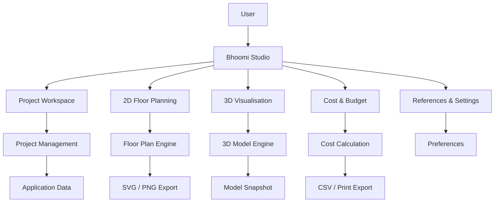

# 🏡 Bhoomi Studio

### A Modern Residential Planning & Architectural Visualisation Platform

**Plan smarter. Visualise better. Build with confidence.**

---

## Overview

Bhoomi Studio is an independently developed residential planning and architectural visualisation platform designed to simplify how people conceptualise, organise, and explore residential spaces.

The platform brings together interactive 2D floor planning, multi-storey 3D visualisation, project management, furniture customisation, and preliminary construction cost estimation within a unified workspace.

Currently operating as an early-stage functional prototype, Bhoomi Studio serves as the foundation for a much larger vision: developing a comprehensive digital ecosystem for residential planning, intelligent design assistance, and architectural exploration.

The objective is not simply to create another floor-plan editor, but to progressively build a platform that connects design decisions with spatial understanding, practical constraints, and financial considerations.

---

## Project Information

| Attribute | Details |
|---|---|
| Project Name | Bhoomi Studio |
| Category | Residential Planning & Visualisation |
| Development Stage | Early-stage Prototype |
| Frontend | React / TypeScript / Vite |
| Deployment | Vercel |
| Version | 1.0.0 |
| Maintainer | Akshat Bhati |
| Repository | GitHub |

---

## Current Features

### 1. Project Workspace
- Create, duplicate, and delete projects.
- Organise residential planning projects.
- Upload land maps and reference images.
- Start projects using the built-in studio sketch.
- Manage individual project information.

### 2. New Project Wizard
A guided project creation workflow featuring:
- Plot information and orientation.
- Architectural style selection.
- Storey configuration.
- Finishing preferences.
- Preliminary budget selection.
- Reference image management.

### 3. Project Overview
A central dashboard containing:
- Project summary.
- Site information.
- Floor plan overview.
- Concept approval status.
- Preliminary cost information.

### 4. Interactive 2D Floor Planning
- Ground, first, second, and roof-level views.
- Storey-aware floor plan switching.
- Blueprint and paper presentation modes.
- Furniture visibility controls.
- Dimension visibility controls.
- Room schedules.
- SVG and high-resolution PNG exports.

### 5. 3D Architectural Visualisation
Interactive dollhouse-style visualisation featuring:
- Multi-storey building representation.
- Individual floor isolation.
- Exploded building view.
- Sun-path visualisation.
- Automatic rotation.
- Snapshot export.

### 6. Cost & Budget Estimation
- Meerut-oriented preliminary turnkey estimates.
- Adjustable project budget from ₹10 lakh to ₹80 lakh.
- Furniture and appliance costing.
- Custom furniture budgets.
- Staircase and opening configuration.
- CSV export.
- Printable cost summaries.

### 7. Furniture & Appliance Customisation
- Essential, Comfort, and Luxe packages.
- 100+ furniture options.
- 36 appliance options.
- Quantity adjustment and removal.
- Individual cost tracking.
- Custom budget configuration.

### 8. Reference Management
- Upload design references.
- Add notes.
- Image lightbox.
- Remove references.

### 9. Personalisation
- Dark and light themes.
- Multiple design palettes.
- Reduced-motion preference.
- Orientation-aware interface content.

---

## Technology Stack

| Technology | Purpose |
|---|---|
| React | User interface |
| TypeScript | Type safety and application logic |
| Vite | Development and production builds |
| HTML5 | Application structure |
| CSS | Styling and responsive interface |
| SVG | Vector-based floor plan rendering |
| JavaScript | Interactive functionality |
| npm | Dependency management |
| Git & GitHub | Version control |
| Vercel | Deployment |

---

## Application Architecture

The current implementation follows a frontend-oriented architecture.



*This diagram represents the conceptual application structure, not a claim of a fully implemented distributed backend.*

---

## Getting Started

### Prerequisites

- Node.js (LTS recommended).
- npm.
- Git.
- Visual Studio Code or another code editor.

### 1. Clone the Repository

```bash
git clone https://github.com/Akshatbhati31/house-plan.git
```

### 2. Navigate to the Project

```bash
cd house-plan
```

### 3. Install Dependencies

```bash
npm install
```

### 4. Start Development Server

```bash
npm run dev
```

### 5. Build for Production

```bash
npm run build
```

### 6. Preview Production Build

```bash
npm run preview
```

---

## Live Application

**Production Website:**

https://house-plan-three.vercel.app

Bhoomi Studio is deployed through Vercel using GitHub integration.

The production branch is `main`. New commits can automatically trigger production deployments.

---

## Development Roadmap

Bhoomi Studio is intended to evolve significantly beyond its current prototype.

The following roadmap represents planned development directions, not currently available features.

### Phase 1 — Foundation & Refinement
- [x] Initial interactive planning interface.
- [x] Multi-storey floor plan visualisation.
- [x] Interactive 3D house model.
- [x] Preliminary cost estimation.
- [x] Furniture and appliance configuration.
- [x] Production deployment.
- [ ] Improve component modularity.
- [ ] Expand testing and validation.
- [ ] Optimise application performance.

### Phase 2 — Advanced Architectural Planning
- [ ] Flexible plot geometry.
- [ ] Advanced room arrangement and editing.
- [ ] Improved dimensioning and measurement tools.
- [ ] Detailed architectural components.
- [ ] Expanded building materials catalogue.
- [ ] More accurate cost estimation.
- [ ] Advanced drawing and export workflows.

### Phase 3 — Intelligent Design Assistance
- [ ] AI-assisted residential layout generation.
- [ ] Natural-language design instructions.
- [ ] Orientation-aware design suggestions.
- [ ] Intelligent space utilisation recommendations.
- [ ] Automated preliminary design evaluation.
- [ ] Personalised design recommendations.

### Phase 4 — Platform Expansion
- [ ] User authentication and accounts.
- [ ] Cloud-based project storage.
- [ ] Cross-device project synchronisation.
- [ ] Collaboration and project sharing.
- [ ] Architect and designer workspaces.
- [ ] Project version history and restoration.

### Phase 5 — Professional Ecosystem
- [ ] Advanced architectural modelling.
- [ ] Detailed material and quantity estimation.
- [ ] Professional project documentation.
- [ ] Contractor and architect collaboration.
- [ ] Regional construction cost databases.
- [ ] Integration with architectural workflows.

---

## Design Philosophy

Bhoomi Studio is being developed around five principles:

**1. Accessibility** — Make residential planning approachable.

**2. Visual Clarity** — Make complex spatial information understandable.

**3. Practicality** — Connect design decisions with budgets and real-world constraints.

**4. Scalability** — Establish a foundation for future capabilities.

**5. Continuous Improvement** — Develop through iterative refinement and testing.

---

## Limitations & Disclaimer

Bhoomi Studio is currently an experimental residential planning and visualisation prototype.

- Generated layouts are not certified architectural drawings.
- Cost estimates are indicative and may differ from actual market prices.
- Structural integrity and building-code compliance are not guaranteed.
- 3D visualisations are representations, not construction specifications.
- Electrical, plumbing, ventilation, and structural systems require professional assessment.

The application must not be considered a substitute for qualified architectural or engineering services.

All construction decisions should be reviewed by appropriately qualified professionals.

---

## Ownership & Licensing

Bhoomi Studio is an independently developed project owned and administered by **Akshat Bhati**.

Copyright © 2026 Akshat Bhati. All Rights Reserved.

This repository is distributed under a proprietary, all-rights-reserved license.

Viewing the source code for evaluation and reference does not grant permission to reproduce, modify, redistribute, commercially exploit, or create derivative works from the proprietary materials.

Third-party components remain subject to their respective licenses.

Refer to the [LICENSE](LICENSE) file for complete licensing terms.

---

## Author & Maintainer

**Akshat Bhati**

Founder, Developer & Project Administrator — Bhoomi Studio

- GitHub: https://github.com/Akshatbhati31
- Repository: https://github.com/Akshatbhati31/house-plan
- Live Application: https://house-plan-three.vercel.app

For project-related enquiries, suggestions, and collaboration requests, please contact the repository owner through GitHub.

---

<p align="center">

**BHOOMI STUDIO**

*From a simple plot to a thoughtfully planned home.*

Copyright © 2026 Akshat Bhati. All Rights Reserved.

</p>
